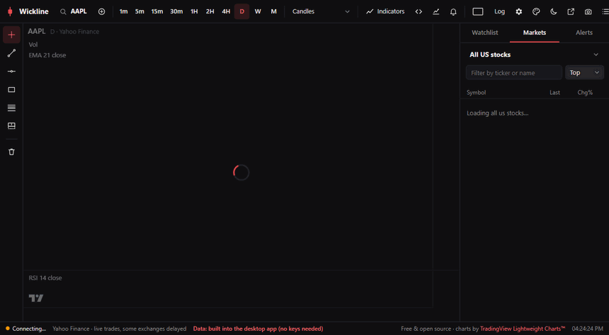

# Wickline

A free, open-source charting platform.
- Live crypto, stocks, ETFs, indices, forex and futures.
- 55 built-in indicators, plus your own indicators and strategies written in JavaScript, with backtesting.
- Drawing tools, price alerts and multi-chart layouts.
- No account, no API keys, no subscription.

**[Download the desktop app](../../releases/latest)** for Windows, macOS or Linux. Everything, including stocks, works out of the box, using your own internet connection.



## Features

**Markets & data**
- Crypto from **Binance** (spot), **Binance Futures** (USDⓈ-M perpetuals) and **Coinbase**: every trade moves the chart in real time. No key needed.
- Stocks, ETFs, indices and forex worldwide. The desktop app gets them from Yahoo with no key; the website version uses each visitor's free **Twelve Data** key for history. Live trades come from Yahoo's public stream. See [Data sources](#data-sources).
- **Markets panel with complete markets:** filter by name, sector or quote coin, and sort by size, gainers, losers or A–Z. Only on-screen rows are drawn and live-updated, so thousands of rows stay fast.
  - All 7,233 US-listed stocks and 5,524 US ETFs.
  - Every pair on Binance (3,000+), Binance Futures (800+) and Coinbase (500+).
- **Curated lists:** 283 hand-picked instruments in 12 groups (world indices, European and Asian stocks, forex, commodities, futures, bond yields…).
- **Live screeners:** top gainers, losers, most active, trending, and more.
- **Symbol search** across all sources, with filters (Stocks, Funds, Futures, Forex, Crypto, Indices).

**Charts**
- **Layouts:** 1, 2, 3, 4 or 6 charts at once, each with its own symbol, timeframe and indicators.
- **Working with several charts:**
  - The crosshair is synced across charts.
  - Maximize any chart, or pop it out into its own window.
- **Chart types:** candles, hollow candles, Heikin Ashi, bars, line, line with markers, step line, area, baseline, columns.
- **Timeframes:** 1m, 5m, 15m, 30m, 1H, 2H, 4H, D, W, M.
- **Display:**
  - Log or percent scale.
  - **Compare** other symbols on the same chart.
  - A bar-close countdown.
  - Light and dark themes, with five presets (Crimson, Ember, Dusk, Signal, Ink).
  - **Every color is yours to pick:** accent, background, panels, text, chart background, grid, crosshair, up/down candles, wicks and line charts. Open the palette button in the header.
- **Extended hours:** on intraday stock charts, pre-market and after-hours trades build candles too, with full history (the **Ext** button turns it off). Overnight trades (20:00–04:00 New York time) have no free candle history, so they show as an "Overnight" price line, as do all extended-hours trades on daily and longer charts.

**Indicators**
- **55 built in, by category:**
  - **Moving averages:** SMA, EMA, WMA, HMA, DEMA, TEMA, SMMA, VWMA, ALMA, LSMA, MA Cross.
  - **Bands & channels:** Bollinger, Keltner, Donchian, Envelopes.
  - **Trend:** Supertrend, Ichimoku Cloud, Parabolic SAR, VWAP, Pivot Points.
  - **Oscillators:** RSI, Stochastic RSI, Stochastic, CCI, Williams %R, MFI, Ultimate, CMO, Fisher, TSI, TRIX, DPO, Coppock, %B.
  - **Momentum:** MACD, Awesome Oscillator, Momentum, ROC, Balance of Power, Elder Force.
  - **Trend strength:** DMI/ADX, Aroon, Vortex, Choppiness.
  - **Volume:** Volume, OBV, A/D, CMF, Chaikin Oscillator, PVT, Volume Oscillator.
  - **Volatility:** ATR, Historical Volatility, BB Width, Standard Deviation.
- Shaded bands and clouds; every setting and color is editable.
- **Your own indicators in JavaScript**, with a built-in editor. See [below](#writing-your-own-indicators).

**Backtesting**
- **Strategy API:** write trading strategies in the same script language. See [below](#backtesting-strategies).
- **Strategy Tester:**
  - Overview with net profit, win rate, profit factor and max drawdown.
  - Equity curve against buy & hold, with drawdown.
  - Performance table split into long and short.
  - List of trades: click a trade to see it on the chart, or export to CSV.
  - Editable properties: capital, order size, commission, slippage, pyramiding, fill timing.
- **On the chart:** entry and exit markers, plus a line from each entry to its exit.

**Drawing & alerts**
- **Drawing tools:**
  - **Lines:** trend line, ray, extended line, arrow.
  - **Levels:** horizontal line, horizontal ray, vertical line.
  - **Shapes & text:** rectangle, parallel channel, text.
  - **Analysis:** Fibonacci retracement, measure, long position, short position.
- **Editing:** drag drawings and their handles. Change colors from the drawing's toolbar.
- **Price alerts:** crossing, crossing up or crossing down. You get a sound, an on-screen message and an optional desktop notification. Create them from a horizontal line with one click.

**Everything else**
- Watchlist with live prices.
- Saves your layout, charts, drawings, scripts and alerts on your computer.
- Shareable links, such as `/#s=YAHOO:AAPL&tf=1D`.
- Save the chart as a PNG.
- Keyboard shortcuts.
- Works on phones.

## Get it

**Desktop app (recommended).** Download the installer for your system from [Releases](../../releases/latest):

| System | File |
| --- | --- |
| Windows | `Wickline-Setup-x.y.z.exe` (installer) or `Wickline-x.y.z-portable.exe` (no install) |
| macOS | `Wickline-x.y.z-arm64.dmg` (Apple silicon) or `Wickline-x.y.z-x64.dmg` (Intel) |
| Linux | `Wickline-x.y.z-x86_64.AppImage` or `.deb` |

The app isn't code-signed, because signing certificates cost money, so the first launch shows a warning:
- **Windows:** in the "Windows protected your PC" message, click **More info → Run anyway**.
- **macOS:** right-click the app, choose **Open**, then confirm **Open**. On newer macOS versions, go to **System Settings → Privacy & Security → Open Anyway**.
- **macOS says the app "is damaged":** run `xattr -cr /Applications/Wickline.app` in Terminal. That removes the "downloaded from the internet" flag.

The app runs a small data server inside itself. It listens only on your own computer (`127.0.0.1`), and stock data comes from Yahoo over your own connection.

**From source.** Requires [Node.js](https://nodejs.org/) 22+.

```bash
git clone https://github.com/keptaduona/wickline.git
cd wickline
npm install
npm run desktop     # the desktop app
npm start           # or: the same app in your browser at http://localhost:5173
```

**Build installers yourself:**
- `npm run dist` builds for the system you're on; the files appear in `dist/`.
- Releases build all three systems automatically, through `.github/workflows/release.yml`:
  1. Bump `version` in `package.json`.
  2. Push a tag such as `v0.2.0`.
  3. GitHub builds the Windows, macOS and Linux apps and attaches them to a draft release.
  4. Review it and press **Publish**.

**As a website (optional).** The `public/` folder is also a complete static site. Put it on any static host for free.
- **Stocks there:** each visitor adds their own free Twelve Data key, since there's no built-in server. See [Data sources](#data-sources).
- **GitHub Pages:**
  1. In **Settings → Pages**, set **Source** to **GitHub Actions**.
  2. Run the *Deploy to GitHub Pages* workflow.
- **Other hosts:** Netlify, Cloudflare Pages and the like serve the `public` folder with no build step.

To try that mode locally, serve `public/` with any static server:

```bash
npx serve public
```

## Data sources

| | Website (static) | Desktop app, or `npm start` |
| --- | --- | --- |
| Crypto: Binance, Binance Futures, Coinbase | ✅ live, no key | ✅ |
| Indicators, scripts, backtesting, drawings, alerts | ✅ | ✅ |
| Stocks, ETFs, indices, forex: history | ✅ with the visitor's **free Twelve Data key** | ✅ Yahoo, no key |
| Stocks, ETFs, indices, forex: live trades | ✅ Yahoo's public stream, no key | ✅ |
| All US stocks and ETFs in the Markets panel | ✅ prices fill in while markets trade | ✅ live |
| Symbol search | ✅ | ✅ |
| Live screeners (top gainers, losers, most active…) | — | ✅ |
| Futures and most world indices | — | ✅ |

**For visitors:** stocks need a free key.
1. Click the ⚙ (Data sources) in the header, or the button on any stock chart.
2. Paste a free key from [twelvedata.com](https://twelvedata.com/pricing). It allows 800 requests a day and 8 a minute.
3. The key is saved only in that browser and sent only to Twelve Data.

Each chart load uses one request. Live prices come from Yahoo's stream and don't use any.

**The server** (`server.mjs`, Node.js 22+, no dependencies) removes the need for a key. It relays Yahoo Finance and Nasdaq, which block requests made directly from web pages.
- The desktop app has it built in. `npm start` runs it alone.
- The app detects it automatically.
- A static site can also point at someone's server under ⚙ → *Advanced*.

```bash
npm install
npm start          # http://localhost:5173 — PORT=8080 HOST=0.0.0.0 npm start to change
```

## Keyboard shortcuts

| Key | Action |
| --- | --- |
| Any letter or digit | Open symbol search |
| `/` | Indicators & scripts |
| `Alt+A` | Create a price alert |
| `Alt+T` · `Alt+H` · `Alt+V` | Trend line · horizontal line · vertical line |
| `Alt+R` · `Alt+C` · `Alt+X` | Rectangle · parallel channel · text |
| `Alt+F` · `Alt+M` | Fib retracement · measure |
| `Alt+Enter` | Maximize / restore the active chart |
| `Esc` | Cancel drawing / close dialog |
| `Delete` / `Backspace` | Delete the selected drawing |
| `Ctrl+S` · `Ctrl+Enter` | In the script editor: save · add to chart |

**Using the toolbar:**
- Hover a toolbar button and click the small arrow to see more tools in that group.
- With the cursor tool, click a drawing to select it, then drag it or its handles.
- In a multi-chart layout, click a chart to make it active. The header, toolbar, watchlist and search act on it.

## Symbols

Symbols are written as `SOURCE:TICKER`:

| Example | Market |
| --- | --- |
| `BINANCE:BTCUSDT` | Crypto spot (any Binance pair) |
| `BINANCEF:BTCUSDT` | Crypto perpetual (Binance USDⓈ-M futures, shown as `BTCUSDT.P`) |
| `COINBASE:BTC-USD` | Crypto spot on Coinbase |
| `YAHOO:AAPL` · `YAHOO:VOW3.DE` · `YAHOO:7203.T` | Stocks (Yahoo suffixes for other exchanges) |
| `YAHOO:SPY` | ETF |
| `YAHOO:^GSPC` · `YAHOO:^GDAXI` | Indices |
| `YAHOO:EURUSD=X` | Forex |
| `YAHOO:GC=F` · `YAHOO:ES=F` | Futures |
| `YAHOO:^TNX` | US 10-year yield |

## Writing your own indicators

Open **Script editor** in the header, pick a starter from **New ▾**, and press **Ctrl+Enter** to save it and put it on the chart. Scripts are plain JavaScript. Every data series is an array with one value per bar, oldest first.

```js
// Two EMAs with a shaded gap and buy/sell markers where they cross.
indicator('EMA Cross Signals', { overlay: true });

const fastLength = input('Fast EMA', 9, { min: 1 });
const slowLength = input('Slow EMA', 21, { min: 1 });

const fast = ta.ema(close, fastLength);
const slow = ta.ema(close, slowLength);

const a = plot(fast, { title: 'Fast', color: '#00BCD4' });
const b = plot(slow, { title: 'Slow', color: '#FF9800' });
fill(a, b, { color: 'rgba(0, 188, 212, 0.08)' });

marker(ta.crossover(fast, slow), { position: 'below', shape: 'up', color: '#089981', text: 'Buy' });
marker(ta.crossunder(fast, slow), { position: 'above', shape: 'down', color: '#F23645', text: 'Sell' });
```

### API

| | |
| --- | --- |
| `indicator(name, { overlay, precision, shortName })` | Name the script. `overlay: true` draws on the price chart, otherwise it gets its own pane. |
| `input(title, default, { min, max, step, options })` | A setting shown in the indicator's settings: number, `true`/`false`, or a list with `options`. Returns its current value. |
| `plot(values, { title, color, style, width })` | Draws a series. `style`: `line`, `histogram`, `dots`, `step`. `color` can be one color, an array with a color per bar, or `(i, value) => color`. Returns an id for `fill`. |
| `hline(price, { color })` | A dashed horizontal level. |
| `fill(a, b, { color })` | Shades between two plots (ids from `plot`) or two numbers. |
| `marker(conditions, { position, shape, color, text })` | A marker on every bar where the condition is true. `position`: `above`/`below`; `shape`: `up`, `down`, `circle`, `square`. |
| `log(...values)` | Prints to the editor's console. |
| Data | `open high low close volume time hl2 hlc3 ohlc4 bar_index`, `n` (bar count), `symbol`, `timeframe.seconds`, `timeframe.intraday`. |
| `ta.*` | `sma ema wma rma hma dema tema alma vwma linreg stdev sum cum highest lowest change mom roc shift rsi cci macd bb stoch crossover crossunder cross pivothigh pivotlow`, plus bar-based `atr tr mfi obv wpr vwap psar dmi supertrend`. |
| Helpers | `na`, `nz(x, 0)`, `add sub mul div max min` (arrays or numbers), `iff(cond, a, b)`, `rgba(hex, alpha)`, and all of `Math`. |

**How scripts run:**
- **Isolated:** each script runs in a separate Web Worker, with no access to the page, your data or the DOM.
- **Time limit:** a script is stopped after 3 seconds, so an endless loop can't freeze the app.
- **Errors:** shown in the editor's console and on the chart, with the line number.
- **Live updates:** saving a script updates every chart that uses it.
- **Your own risk:** scripts are code; only run scripts from sources you trust.

## Backtesting strategies

Write `strategy()` instead of `indicator()` and place orders. Press **Ctrl+Enter** and the **Strategy Tester** opens with the results:

```js
strategy('EMA Cross Strategy', { capital: 10000, size: { percent: 100 }, commission: 0.1 });

const fast = ta.ema(close, input('Fast EMA', 12));
const slow = ta.ema(close, input('Slow EMA', 26));
plot(fast, { color: '#00BCD4' });
plot(slow, { color: '#FF9800' });

strategy.entry('Long', 'long', ta.crossover(fast, slow));    // an opposite entry reverses the position
strategy.entry('Short', 'short', ta.crossunder(fast, slow));
strategy.exit({ stopLoss: 3, takeProfit: 6 });               // percent from the entry price
```

| | |
| --- | --- |
| `strategy(name, options)` | `capital` (default 10,000), `size`: `{ percent }` of equity (default 100), `{ cash }` or `{ qty }`. Also `commission` and `slippage` (% per fill), `pyramiding` (max entries in one direction, default 1), and `fillOn`: `'open'` (next bar's open, default) or `'close'`. |
| `strategy.entry(id, 'long'\|'short', when, { qty, comment })` | Enter on every bar where `when` is true. `when` is an array, `true`, or `(i) => boolean`. |
| `strategy.close(id, when)` | Close the entries with that id; `null` closes everything. `strategy.closeAll(when)` is the same as `close(null, when)`. |
| `strategy.exit({ stopLoss, takeProfit, trailing, stopPrice, limitPrice, from })` | Protective exits. The first three are percentages; `stopPrice` and `limitPrice` are price arrays or numbers (for example an ATR stop); `from` limits it to one entry id. |
| `strategy.onBar((i, s) => { … })` | Runs once per bar for logic that depends on the open position. `s.position` → `{ side, qty, avgPrice, openProfit, barsInTrade }`; also `s.equity`, `s.long(id)`, `s.short(id)`, `s.close(id)`. |

**How fills work:**
- Signals are read at a bar's close and fill at the **next bar's open** (or the same bar's close with `fillOn: 'close'`), so a strategy can't see the future.
- Stops, targets and trailing stops are checked against each bar's high and low. A gap past a level fills at the open.
- If one bar touches both the stop and the target, the stop is counted first, the conservative choice.
- Commission and slippage apply to every fill.

**What the backtest covers:**
- Backtests run over the bars loaded on the chart. On crypto charts, scroll left to load more history; daily stock charts load the full history.
- Results update live as new bars arrive.
- The Properties tab overrides the script's settings for that chart.

The engine is plain JavaScript in `public/js/backtest.js`, covered by unit tests (`npm test`).

Past performance doesn't predict future results, and a backtest is only as good as its data and assumptions.

### Adding a built-in indicator

Built-ins live in `public/js/indicators.js`. Add an entry and it appears in the Indicators dialog with settings, legend values and live updates:

```js
momentum: {
  name: 'Momentum', short: 'MOM', description: 'Close minus the close N bars ago',
  category: 'Momentum', overlay: false,
  params: [P('length', 'Length', 10)],
  plots: [{ key: 'mom', title: 'MOM', color: '#00BCD4' }],
  calc: (bars, p) => ({ mom: change(bars.map((b) => b.close), p.length) }),
},
```

## How it works

```
Desktop app (desktop/main.mjs, Electron):
  └── a window on http://127.0.0.1:41573 ─▶ the web app below + the server, on your machine only

Web app (public/, plain static files), in the window or any browser:
  ├── Binance · Binance Futures · Coinbase ......... crypto history + every trade (WebSocket)
  ├── Yahoo live price stream (WebSocket) .......... live stock/forex trades
  ├── Server, if present (detected via /api/health)
  │     └── /api/yahoo/*, /api/universe/* ─▶ Yahoo Finance, Nasdaq   (keyless stocks, screeners, live lists)
  └── Without a server (website):
        ├── Twelve Data (visitor's free key) ....... stock/ETF/forex/index history, quotes, search
        └── data/us-stocks.json, us-etfs.json ...... US tickers, names and sectors (no prices)
```

| File | What it does |
| --- | --- |
| `desktop/main.mjs` | The desktop app: starts the server on `127.0.0.1`, opens the window, remembers its size, opens pop-out charts as app windows. |
| `build/icon.png`, `.github/workflows/release.yml` | App icon, and the workflow that builds Windows/macOS/Linux installers for each tagged release. |
| `public/` | **The web app.** Static files only, no build step. |
| `public/js/env.js` | Detects the optional server and holds the data settings (key, rate, server URL). |
| `public/js/twelvedata.js`, `yahoo-direct.js` | Static-site data: Twelve Data client with a built-in rate limiter, and Yahoo's live stream decoded in the browser. |
| `public/js/datafeed.js` | History and live data for each exchange and source, symbol search, and live quote lists. |
| `server.mjs`, `lib/` | The optional server: relays Yahoo and Nasdaq (which block browsers), caches responses, and shares one Yahoo stream connection with every open window. |
| `scripts/update-data.mjs` | Refreshes `public/data/` (all US stocks and ETFs): `npm run update-data`. |
| `public/vendor/` | The chart library, bundled so the site needs no build step (`npm run update-vendor` refreshes it). |
| `public/js/chart-view.js` | One chart: series, indicator panes, scripts, compare, legend, drawings, alerts. Each trade updates the current bar at once; official bars are merged in to keep it exact. |
| `public/js/app.js` | The shell: layouts, header, toolbar, side panel, dialogs, shortcuts. |
| `public/js/indicators.js` | All indicator math, also exposed to scripts as `ta`. |
| `public/js/scripts.js`, `script-worker.js`, `script-editor.js` | Script storage, the sandboxed runner, and the editor. |
| `public/js/backtest.js`, `strategy-tester.js` | The bar-by-bar backtest engine and the Strategy Tester panel. |
| `test/` | `npm test`: offline unit tests (backtest engine, strategy API and templates, all 55 indicators, bad-print filter, data decoding, server). `npm run test:e2e`: drives the real desktop app with live data (needs internet). |
| `public/js/drawings.js`, `primitives.js` | Drawing tools, shaded bands and the countdown, drawn through the chart library's plugin API. |
| `public/js/markets.js`, `market-browser.js`, `quote-list.js`, `alerts.js`, `search.js` | Markets catalog, the fast-scrolling markets list, the watchlist, alerts, symbol search. |

Charts are rendered with [TradingView Lightweight Charts™](https://www.tradingview.com/lightweight-charts/), an open-source (Apache-2.0) charting library.

## Data notes and limits

- **Crypto exchanges** need no keys.
  - Binance and Binance Futures aren't available in some countries (for example the US). There, use Coinbase symbols or Yahoo's, such as `YAHOO:BTC-USD`.
  - Coinbase history is fetched in pages, so it's shorter than Binance's.
- **Twelve Data** (static site) is an official API with a free plan: 800 requests a day, 8 per minute.
  - Wickline queues requests to stay within the limit. Raise the limit in ⚙ if you have a paid plan.
  - Some exchanges and instruments need a paid Twelve Data plan; their message is shown on the chart.
  - It has no futures. Gold and silver map to spot XAU/USD and XAG/USD.
- **Yahoo** is an unofficial, undocumented source. Both its live stream (used directly by the static site) and its history API (used by the optional server) can change or rate-limit without notice.
  - Some exchanges are delayed (often 15 minutes).
  - With the server, intraday history is limited: 1m covers about 7 days, 5m–30m about 60 days, 1H–4H about 2 years.
- **Full US stock and ETF lists** come from Nasdaq's public (unofficial) screener.
  - In the desktop app (and with `npm start`) they're refreshed every 10 minutes.
  - On a static website, `public/data/` holds only tickers, names and sectors, which are facts and not anyone's market data. Prices fill in from the live stream while markets trade, or from the visitor's Twelve Data key. Refresh the lists with `npm run update-data`; the Pages workflow does this on each deploy.
  - Prices on screen update live. % change can lag by a session; for real-time movers, use the screeners (server).
- **When charts move:** only while their market trades.
  - Crypto trades 24/7; forex around the clock on weekdays.
  - Stocks: intraday candles include pre-market and after-hours trades (turn off with **Ext**). Overnight trades, and extended-hours trades on daily and longer charts, show as a separate price line.
- **Alerts** are checked while Wickline is open (the app or a browser tab). Nothing runs in the cloud.
- **Storage:** settings, watchlist, drawings, scripts and alerts stay on your computer. They're kept in the desktop app's profile, or in the browser's `localStorage` for the website.

**This is not financial advice.** Data can be delayed or wrong; don't rely on it for trading decisions.

## Roadmap ideas

- Bar replay
- Volume profile
- Alerts on indicator values and script conditions
- More drawing tools (Fibonacci extensions, pitchfork, brush)
- Sharing scripts with other people
- More data sources (e.g. Kraken, OKX, or keyed providers like Alpaca/Polygon)

Contributions are welcome. Open an issue or a pull request.

## License

[MIT](LICENSE).

Charts are powered by [TradingView Lightweight Charts™](https://github.com/tradingview/lightweight-charts) (Apache-2.0), © TradingView, Inc. Its license requires attribution, which the TradingView logo on the chart and the link in the status bar provide. Keep them, or add equivalent attribution, if you modify Wickline.

Wickline is an independent project and is not affiliated with or endorsed by TradingView, Binance, Coinbase or Yahoo.
